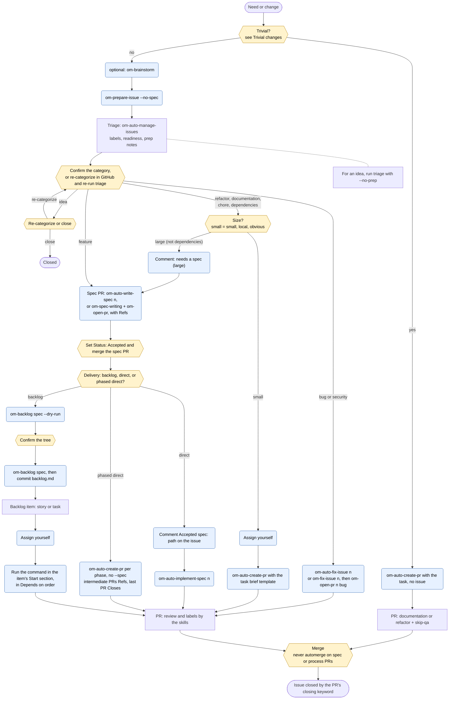

# Issue routes: flow diagram

This diagram illustrates [`SDLC.md` § Routes](SDLC.md#routes). The table there is the source of truth: when the diagram and the table disagree, the table wins. Update this file whenever § Routes changes.

**Legend.** Each node shape has one meaning:
- **Hexagon:** a human decision.
- **Rounded box:** a command a human runs. All **[H]** steps in § Routes are one of these two shapes.
- **Plain box:** what a skill or GitHub does on its own.

Readiness never starts work. Before each human command, check the readiness column of § Routes.

**Do not use** (from § Routes):

| Route | Do not use |
|---|---|
| idea | any spec or implementation command |
| feature | `om-auto-fix-issue`, `om-prepare-issue` without `--no-spec`, triage with `--write-missing-specs` |
| backlog item | `om-auto-fix-issue`, `om-auto-implement-spec`, `om-auto-create-pr --spec`, or any brief naming the parent spec |
| refactor, documentation, chore | `om-auto-fix-issue` |
