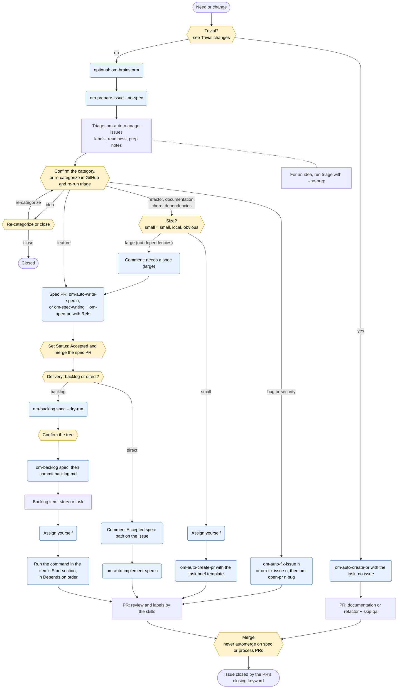
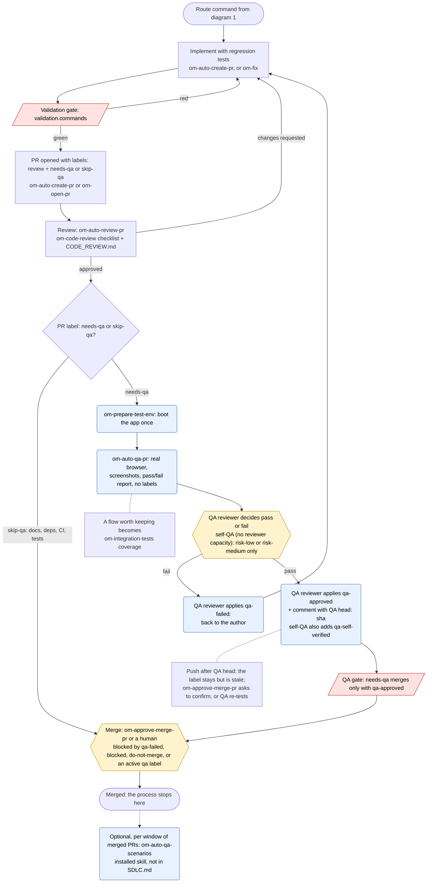
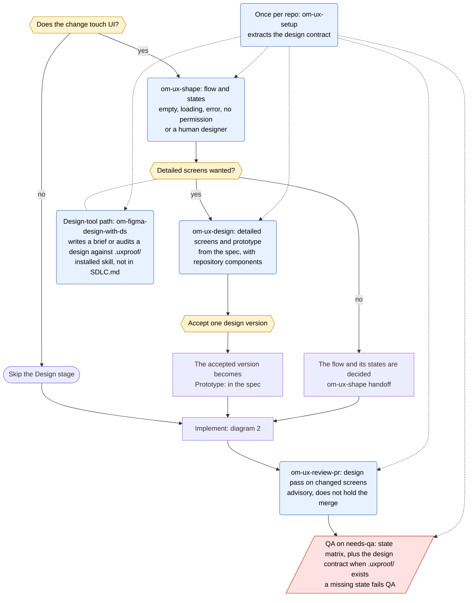

# SDLC flow diagrams

Three small diagrams, each answering one question:
1. **Routes:** which route does an issue take?
2. **PR path:** where do tests and QA happen, from code to merge?
3. **Design:** how does a user-facing change get designed?

They illustrate [`SDLC.md`](SDLC.md), which is the source of truth. When a diagram and `SDLC.md` disagree, `SDLC.md` wins. Update this file whenever the sections each diagram cites change.

**Legend** (shared by all three):
- **Hexagon (yellow):** a human decision.
- **Rounded box (blue):** a command a human runs. All **[H]** steps in § Routes are one of these two shapes.
- **Plain box:** what a skill or GitHub does on its own.
- **Slanted box (red):** a gate that blocks the merge until it passes.
- **Diamond:** a branch that follows a label, not a new decision.
- **Pill:** a start or an end.

The diagrams connect: the commands that lead into the **PR** node of diagram 1 expand into diagram 2, and diagram 3 is the Design stage, which comes before implementation for any user-facing change; for a feature, `om-ux-design` works from the spec.

## 1. Routes

Source: [`SDLC.md` § Routes](SDLC.md#routes). Readiness never starts work: before each human command, check the readiness column of § Routes.

**Do not use** (from § Routes):

| Route | Do not use |
|---|---|
| idea | any spec or implementation command |
| feature | `om-auto-fix-issue`, `om-prepare-issue` without `--no-spec`, triage with `--write-missing-specs` |
| backlog item | `om-auto-fix-issue`, `om-auto-implement-spec`, `om-auto-create-pr --spec`, or any brief naming the parent spec |
| refactor, documentation, chore | `om-auto-fix-issue` |

## 2. PR path: tests and QA

Sources: [`SDLC.md` § Ticket lifecycle](SDLC.md#ticket-lifecycle) (rows Implement, PR, Review loop, QA, Merge), [§ Label state machine](SDLC.md#label-state-machine), [§ The QA gate](SDLC.md#the-qa-gate), and [§ Validation gate](SDLC.md#validation-gate).

## 3. Design for user-facing changes

Sources: [`SDLC.md` § Ticket lifecycle](SDLC.md#ticket-lifecycle) (rows Design, Review loop), [§ The QA gate](SDLC.md#the-qa-gate) (the UI bullet), and [§ Amending this process](SDLC.md#amending-this-process) (`om-ux-setup`). The Design stage applies to any user-facing change, whether or not it has a spec.

